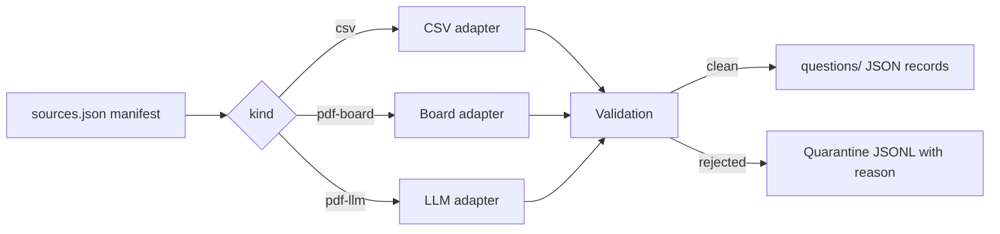

# question-bank

<p align="center">
  
</p>

> Store, validate, and search exam questions locally. Ingest from CSV files, exam-board PDFs, or any PDF with a text layer, with provenance on every question.

question-bank is a local-first engine for building a personal question bank from exam material. One command, `question-bank ingest`, turns declared sources into validated JSON records. Every record carries its source, page range, and extraction adapter, so you always know where a question came from and how it got there.

Ingestion is adapter-based. A generic CSV adapter maps any tabular source through a column-mapping manifest. A deterministic adapter handles the exam-board PDF formats already supported (FGV, IADES, Cesgranrio, FCPC). For any other PDF with a text layer, a language-model adapter extracts candidates one page batch at a time, validates them strictly, and quarantines anything it cannot trust. Scanned PDFs without a text layer are refused: there is no OCR and no guessing.

Retrieval comes from a separate search layer: a local BM25 index that works with no API key, plus optional semantic search through your own embedding endpoint. An MCP server exposes the bank to coding agents, and a web UI browses it. Nothing leaves your machine except the page text you deliberately send to the extraction model and the query chunks you deliberately send to the embedding endpoint.

## How ingestion works



Each source is declared in a `sources.json` manifest with a `kind`, an `exam` slug, and a `year`. Exam names are free-form slugs: `poscomp`, `sat-math`, whatever you are studying. Exam-specific rules apply only to the exams that have them, and every other exam passes the same structural checks. The pipeline writes a candidate only when validation passes; failures land in `reports/ingest-quarantine.jsonl` with the reason. The PDF adapters account for every page: extracted, empty, or explicitly quarantined. Nothing is dropped silently.

Every question also carries concept tags. The tags live in a local registry, `docs/tags.md`: one concept per line with a slug, a display name, and a level (area, topic, or subtopic). Validation checks question tags against that registry, so the bank stays curatable across sources.

## Quick start

```bash
# Declare a source: reports/sources.json next to your bank
cat > reports/sources.json <<'EOF'
[
  {
    "id": "my-exam-2025",
    "kind": "csv",
    "path": "my-exam.csv",
    "exam": "my-exam",
    "year": 2025,
    "options": {"answer_column": "key", "id_prefix": "my-exam-"}
  }
]
EOF

uv run question-bank ingest          # run the pipeline
uv run question-bank doctor          # check configuration and storage
uv run question-search index         # build the local index
uv run question-search query "hash tables"
```

CSV ingestion works offline. PDF ingestion through the LLM adapter needs an OpenRouter key and uses the model in `QUESTION_EXTRACT_MODEL` (default `openai/gpt-4o-mini`) at temperature 0, with one bounded repair call per batch.

## What is inside

| Piece | What it does |
| --- | --- |
| `question-bank` CLI | `ingest`, `doctor`, `diagnose`: run the pipeline, check health, write a redacted diagnostic bundle |
| `src/question_bank/` | Adapters, validation, provenance, quarantine, event journal |
| `question-search` CLI | Local BM25 search, optional semantic search, index status |
| MCP server | Exposes bank queries to coding agents over stdio |
| `web/` | Local web UI for browsing the bank |
| Tags registry | `docs/tags.md`: concept slugs with names and levels, checked at validation |
| `docs/` | `ingestion.md` and more: manifest format, adapters, env vars |

Diagnostics are local by design: `doctor` reports per-check OK/WARN/FAIL and exits nonzero on failure; the JSONL journal keeps 30 days (1 MB) of ingestion and doctor events with secrets scrubbed on write; `diagnose` prints a redacted bundle with no home paths, no file contents, and no key values. There is no telemetry.

## Requirements

- Python 3.12 or newer and [uv](https://docs.astral.sh/uv/)
- Optional: `OPENROUTER_API_KEY` for LLM PDF ingestion and semantic search; `QUESTION_BANK_ROOT` to relocate the bank; `QUESTION_EXTRACT_MODEL` to choose the extraction model

## License

MIT
