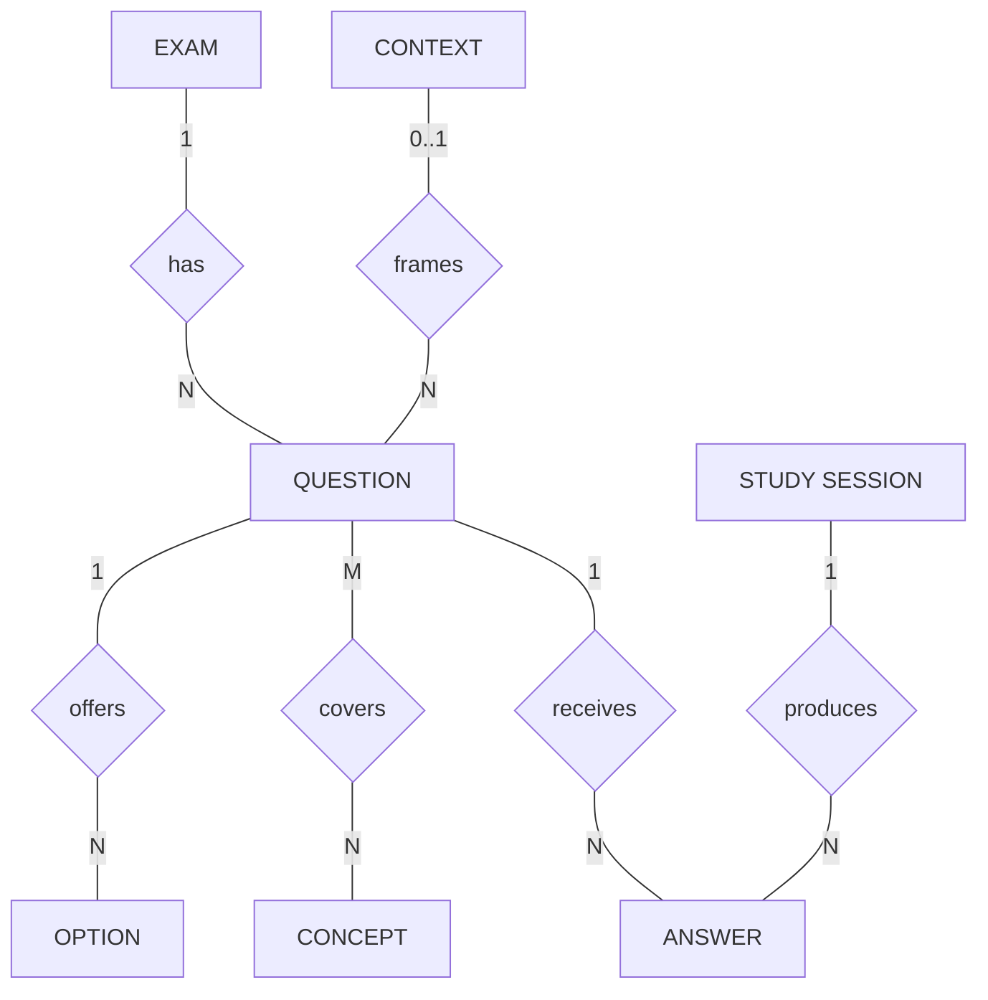

# Conceptual Model — question-bank

The FIRST modeling document, per the classic three-level database design
pipeline (Chen 1976; taught in Brazilian DB courses as MER):

**mini-world → conceptual model (this doc) → logical model → physical model**

Chen notation rules for this level: entities (rectangles), relationships
(diamonds), attributes (minimal), cardinality on edges. NO keys, NO data
types, NO foreign keys — those belong to the logical model (`er-model.md`).
If a detail can't be stated without mentioning implementation, it does not
belong here.

## Entities and relationships (plain statements)

- An **EXAM** has several **QUESTIONS**; each question belongs to exactly one exam.
- A **QUESTION** offers several **OPTIONS**; one of them is correct.
- A **QUESTION** may be framed by a **CONTEXT** (shared case text).
- A **QUESTION** covers several **CONCEPTS**; a concept is covered by many questions.
- A **STUDY SESSION** produces several **ANSWERS**; each answer refers to exactly one question.
- A **QUESTION** receives many **ANSWERS** over time.

## Diagram (Chen-style)

## What this level decided (that the logical model inherits)

1. Seven entities, no more. OPTION is an entity (not a field list) because
   correctness and letter ordering are properties of the alternative, not
   of the question.
2. QUESTION—CONCEPT is N:N — the single junction the whole tag system hangs on.
3. ANSWER exists as its own entity with its own lifetime: the same question
   answered on different days are different facts. This is what makes error
   statistics a query, not a hack.
4. CONTEXTO is optional for both sides — POSCOMP questions have none.

## Next levels

- `er-model.md` = Modelo Lógico (keys, FKs, types, crow's foot).
- Physical = the JSON file layout (`schema.md`) + the runtime SQLite store
  for SESSION/ANSWER.
