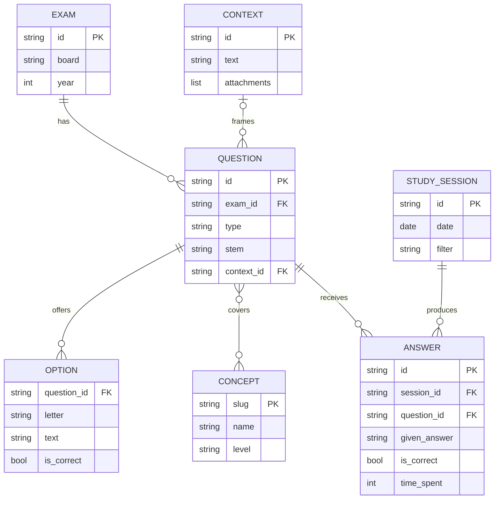

# Conceptual Model (ER) — question-bank

Data modeling step between kickoff and implementation. Conceptual level:
entities, relationships, cardinalities. The JSON file layout (schema.md) is
the *physical* consequence of this model, not the model itself.

## Entities

**EXAM** — an official exam edition.
- id, name (exam board + year), board (SBC, INEP), year

**QUESTION** — one graded item.
- id, type (mc | discursive), stem, number, component (ENADE only)

**OPTION** — an answer alternative of an MC question.
- letter, text, is_correct

**CONTEXT** — shared case text (ENADE shared case block).
- id, text, attachments

**CONCEPT** — a topic a question can cover.
- slug, name, level (area | area-topic | subtopic)

**STUDY_SESSION** — one sitting of practicing.
- id, date, filter (tags/exam/years used)

**ANSWER** — one graded attempt at one question.
- id, given_answer, is_correct, time_spent, confidence (optional)

## Relationships (with cardinality)

```
EXAM        1 —— N  QUESTION      (an exam has N questions; each belongs to exactly 1 exam)
QUESTION    1 —— N  OPTION        (mc only; discursive questions have none)
QUESTION    0..1 —— 1 CONTEXT     (a question may reference one shared case;
                                   a context serves N questions)
QUESTION    M —— N  CONCEPT       (a question covers multiple concepts;
                                   a concept is covered by many questions)
STUDY_SESSION 1 —— N ANSWER       (a session produces N answers)
QUESTION    1 —— N  ANSWER        (a question is attempted many times over time;
                                   each answer is for exactly one question, once)
```

### Diagram (Mermaid — renders on GitHub/Obsidian)



Notes:

- **QUESTION—CONCEPT is the only M:N relationship**, and it is why "tags"
  exist as a separate idea from the question file: the tag list on a
  question IS the instance set of that relationship. The CONCEPT table
  (taxonomy: name, hierarchy level) is the other half.
- **ANSWER is the fact table.** Everything about "which topics do I get
  wrong" is an aggregation over STUDY_SESSION × QUESTION through ANSWER.
  This is the table the future graph layer consumes.
- EXAM was implicit before (a string field); it is now an entity because
  both POSCOMP and ENADE editions exist and gap-filling (source 4) needs
  per-edition coverage tracking.

## Storage mapping (derived, not primary)

| Concept | JSON-file realization |
|---------|----------------------|
| EXAM | fields on each question + derivable from ids |
| QUESTION | one file per question in `questions/` |
| OPTION | `options` array + `answer` letter (is_correct = derivable) |
| CONTEXT | one file per context in `contexts/` |
| QUESTION—CONCEPT instances | `tags` list per question |
| CONCEPT taxonomy | `docs/tags.md` (name + level registry) |
| STUDY_SESSION / ANSWER | NOT json — runtime store (SQLite), never committed |

The file-based bank stores the *content* entities. The *behavior* entities
(sessions, answers) are runtime data — they belong to the runner's store,
not to the bank, because they change constantly and have no business in
version control. If volume or querying ever demands it, this ER model maps
1:1 onto relational tables — the model is the durable artifact, the storage
is an implementation choice.

## Deliberately out of model (anti-scope)

- Users/accounts (single user), srs scheduling fields (parked with
  spaced-repetition), vector embeddings (parked).
