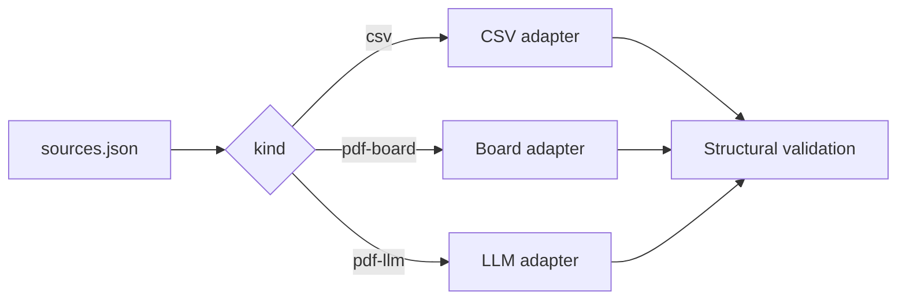
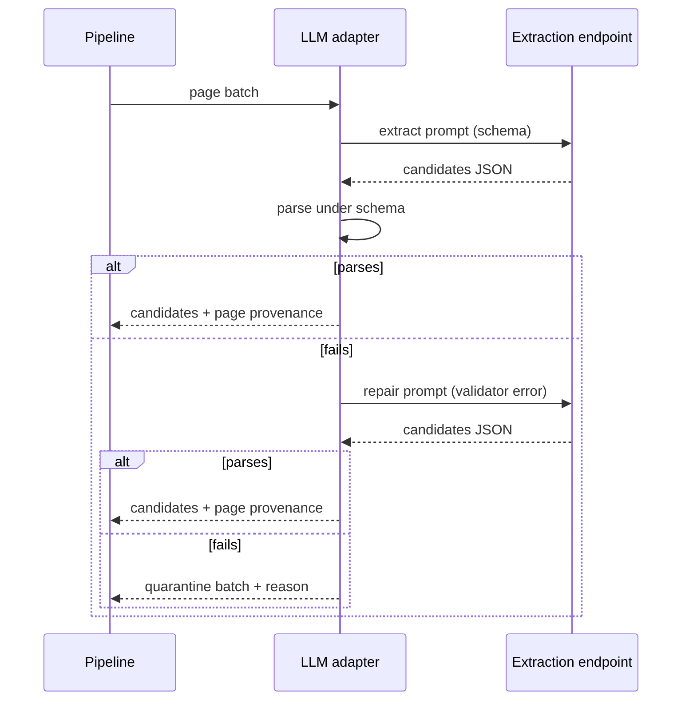
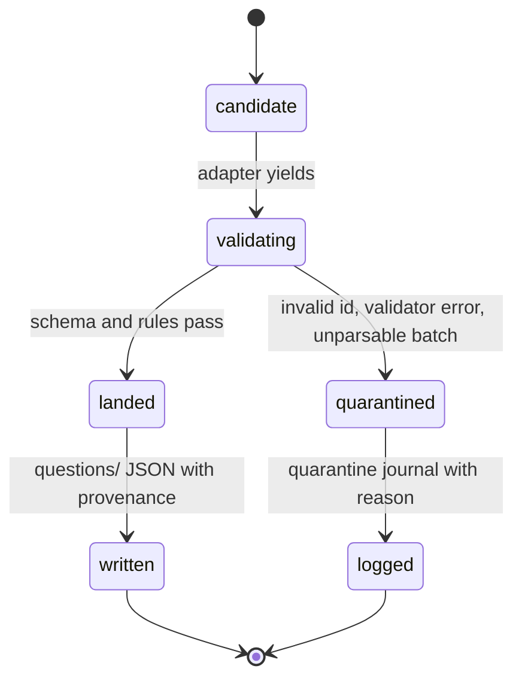
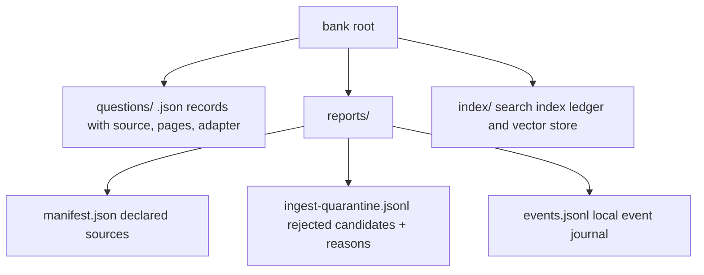

# Architecture

The pipeline is one command with pluggable adapters behind a single
interface. This page walks the stages and the decisions behind each
one, with a diagram per stage.

## Stage 1: dispatch

The manifest declares every source with a `kind`; the dispatcher picks
the matching adapter and yields candidates. Adapters produce
candidates, never writes: only the pipeline persists anything, so no
code path exists from an adapter to the questions directory.

**Exam identity is a slug, not a list.** The manifest declares each
source with a free-form `exam` slug and validation applies only two
kinds of rules: structural rules that every question must pass, and
exam-specific rules that fire only when the record belongs to a known
exam. The why: the tool must take any exam, and gating specific rules
by exam means supporting a new exam requires zero code changes.

## Stage 2: extract (LLM adapter)

Only the LLM adapter talks to a model, and it talks to it in batches
under a strict schema. A batch that comes back unparsable gets exactly
one repair call, with the validator error attached; a batch that still
fails is quarantined and the pipeline moves on.

## Stage 3: validation and landing

Every candidate from every adapter passes the same structural
validation, then takes exactly one of two exits. A question id already
in the bank is skipped, which makes re-runs safe.

**Failure is a record, not an exit.** One unreadable page in a 60-page
booklet should cost one batch, not the whole ingest run. Each rejection
lands in the quarantine journal with source, candidate, and reason
attached.

**Every page is accounted for.** The LLM adapter tracks each page as
extracted, empty, or quarantined, and stamps each candidate with the
page range it came from, the adapter name, and the model used. The why:
provenance is what makes a bank auditable, and page accounting makes
silent drops impossible by construction.

## What lands on disk

The bank root is a plain directory of JSON and logs, relocatable with
`QUESTION_BANK_ROOT`:

**Idempotence is built in.** Running the same ingest twice produces
identical bank files: already-present question ids are skipped, and
quarantine records append, never rewrite. The why: an ingest command
that is safe to re-run needs no state management around crashes and
retries.

**Diagnostics are local and always on.** The event journal records
ingest and doctor activity with secrets scrubbed on write, trims
itself to 30 days and 1 MB, and `diagnose` renders a redacted bundle
for bug reports. It never opens a network connection. The why: a local
tool should be debuggable from local evidence alone.

It never writes to the bank outside ingest. It never drops a candidate
silently. It never reads a scanned page it cannot see. It never sends
bank content anywhere except the endpoints you configure.
