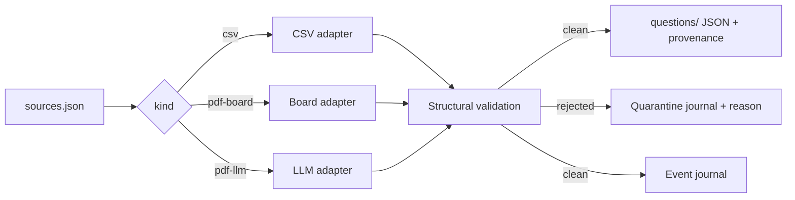

# Architecture

The pipeline is one command with pluggable adapters behind a single
interface. **Adapters produce candidates, never writes.** Every adapter
implements the same read protocol and yields candidate dictionaries;
only the pipeline persists anything. The why: adapters stay dumb and
swappable, and a bad source can never bypass validation, because there
is no code path from an adapter to the questions directory.

**Exam identity is a slug, not a list.** The manifest declares each
source with a free-form `exam` slug and validation applies only two
kinds of rules: structural rules that every question must pass, and
exam-specific rules that fire only when the record belongs to a known
exam. The why: the tool must take any exam, and gating specific rules
by exam means supporting a new exam requires zero code changes.

**Failure is a record, not an exit.** When the LLM adapter fails to
parse a batch, it makes one repair call with the validator error
attached; if the batch still fails, the batch is quarantined with the
reason and the pipeline moves on. The same applies to invalid ids and
records that fail validation: each rejection lands in
`reports/ingest-quarantine.jsonl` with source, candidate, and reason.
The why: one unreadable page in a 60-page booklet should cost one
batch, not the whole ingest run.

**Every page is accounted for.** The PDF adapters track each page as
extracted, empty, or quarantined, and stamp each candidate with the
page range it came from, the adapter name, and the model used. The
why: provenance is what makes a bank auditable, and page accounting
makes silent drops impossible by construction.

**Idempotence is built in.** Running the same ingest twice produces
identical bank files: already-present question ids are skipped, and
quarantine records append, never rewrite. The why: an ingest command
that is safe to re-run needs no state management around crashes and
retries.

**Diagnostics are local and always on.** The event journal records
ingest and doctor activity with secrets scrubbed on write, trims
itself to 30 days and 1 MB, and `diagnose` renders a redacted bundle
for bug reports. It never opens a network connection. The why: a local
tool should be debuggable from local evidence alone.

It never writes to the bank outside ingest. It never drops a candidate
silently. It never reads a scanned page it cannot see. It never sends
bank content anywhere except the endpoints you configure.
